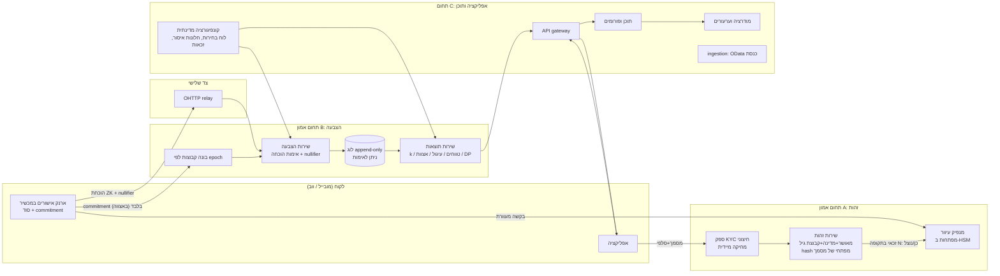
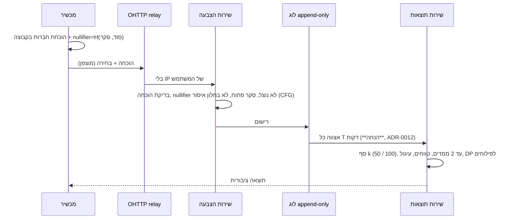

# ארכיטקטורה · GeoPoll

[← חזרה לאינדקס](../../README.md)

- **סטטוס:** טיוטה v0.1 (2026-10-22). ה-stack ([ADR-0016](../decisions/0016-proposed-tech-stack.md)) וסכמת האישורים ([ADR-0017](../decisions/0017-anonymous-credential-scheme.md)) **התקבלו** (נוה, 2026-10-22). מיקום נתונים ורשימת רישיונות פתוחים (עו"ד); יעדי ביצועים ומספרים נשארים **הנחה**.
- **יורש מ:** [README · עקרונות](../../README.md#עקרונות-יסוד-לא-משתנים), [ציר 01](../axes/01-security-identity-privacy.md), [ציר 06](../axes/06-infrastructure-engineering.md), ADRs [0007](../decisions/0007-high-assurance-identity-verification.md), [0012](../decisions/0012-public-results-display-buckets-batching.md), [0014](../decisions/0014-priorities-security-legal-transparency.md), [0015](../decisions/0015-fast-convenient-app.md).
- **מסמכים:** [מודל איומים](threat-model.md) · [מסלול גדילה](scaling-path.md)

## 1. עקרונות ארכיטקטוניים (נגזרים, לא חדשים)
1. **אי-קישוריות מבנית:** שירות הזהות ושירות ההצבעה הם שני "תחומי אמון" נפרדים: חשבון ענן, DB, מפתחות, צוות עם הרשאות production ולוגים נפרדים. **אין טבלה, מפתח, לוג או מזהה משותף** שמקשר אדם לקול (ADR-0007 §4).
2. **מזעור מידע כברירת מחדל:** כל שדה שנשמר מחייב הצדקה בסכמה (schema review).
3. **תוצאה ציבורית = מצרפית בלבד:** סף k, טווחים, עיגול ואצוות (ADR-0012) נאכפים בשירות התוצאות, לא בלקוח.
4. **אבטחה וחוק לפני ביצועים** (ADR-0014). יעדי הביצועים מ-ADR-0015 הם יעדים מוצעים (**הנחה**).
5. **פומביות הקוד הקריפטוגרפי** וספירה שניתן לאמת.

## 2. תמונת מערכת (C4 – רמה 2)

**נקודה קריטית:** החץ היחיד בין תחום A לתחום B עובר **דרך המכשיר של המשתמש**, ולא בין השרתים. אין קריאת שרת-לשרת בין A ל-B.

## 3. גבולות שירותים
| שירות | יודע | **לא** יודע / אסור לשמור | בעלים |
|---|---|---|---|
| זהות (A) | שהאדם עבר KYC; מדינה; קבוצת גיל; hash מפתחי מסמך+מדינה; "נוצל בתקופה N" | ביומטריה (נמחקת מיד), commitment, אישור, nullifier, IP/זמן מדויק | צוות זהות |
| מנפיק עיוור (A) | שנחתם אישור לתקופה N | תוכן האישור (עיוור) | צוות זהות + שומרי מפתחות (threshold) |
| קבוצות (B) | רשימת commitments לתקופה | למי שייך כל commitment | צוות הצבעה |
| הצבעה (B) | הוכחה תקפה, nullifier, בחירה | זהות, חשבון אפליקציה, IP (מאחורי relay) | צוות הצבעה |
| תוצאות (B) | ספירות גולמיות פנימיות | — ; **מפרסם רק** לפי ADR-0012 | צוות הצבעה + data |
| תוכן ומודרציה (C) | חשבון אפליקציה (כינוי), פוסטים, דיווחים | מה המשתמש הצביע | צוות תוכן/T&S |
| ניתוח נתונים | אירועי מוצר מצרפיים | שום אירוע הצבעה פרטני | data |

**הנחה:** חשבון האפליקציה (תוכן) והחשבון בשירות הזהות לא חולקים מזהה. סימון "מאומת" בתוכן נעשה בהוכחת ZK נפרדת (scope "content") ולא בקריאה לשירות הזהות. **דורש אימות הנדסי** ב-PoC.

## 4. זרימת הנפקת אישור (epoch)
```mermaid
sequenceDiagram
  participant U as מכשיר
  participant K as ספק KYC
  participant I as שירות זהות
  participant S as מנפיק עיוור
  participant G as קבוצות (B)
  U->>K: מסמך + סלפי + liveness
  K-->>I: מאושר, מדינה, קבוצת גיל, מס' מסמך (נמחק אצל הספק)
  I->>I: HMAC(מסמך+מדינה) – בדיקת כפילות; שמירת "זכאי לתקופה N"
  U->>S: בקשה מעוורת (commitment מוסתר)
  S->>I: האם זכאי ולא נוצל?
  I-->>S: כן → מסמן "נוצל"
  S-->>U: חתימה עיוורת (באצווה, השהיה אקראית)
  U->>G: commitment + חתימה (דרך relay, בחלון הצטרפות)
  G->>G: בניית קבוצה מחדש בתחילת epoch
```
פרטי הסכמה תלויים ב-ADR-0017.

## 5. זרימת הצבעה ותוצאות


## 6. תוכן, מודרציה ו-API
- **תוכן:** פורומים, עמודי ח"כים/סיעות/הצעות חוק (ingestion מ-OData), פיד מאוזן. Postgres + חיפוש + מטמון (**הנחה**, ADR-0016).
- **מודרציה:** סיווג אוטומטי → תור אנושי → ערעור; כל החלטה מתועדת לדוח השקיפות. נוער: הרשאות מוגבלות (ADR-0006).
- **API:** ציבורי לקריאה (תוצאות מצרפיות בלבד), פנימי לאפליקציה. גרסאות, rate limiting, ותיעוד OpenAPI. **אין endpoint שמחזיר ספירה מדויקת מתחת לסף.**

## 7. לקוחות
- מובייל (iOS/Android) כערוץ ראשי (קהל 18–25, [ציר 11](../axes/11-youth-growth.md)); ווב לקריאה ולהצבעה עם מגבלות. הפקת הוכחות במכשיר; סוד ב-Secure Enclave / StrongBox (**הנחה**).
- יעדי ביצועים מוצעים לפי ADR-0015 (**הנחה**); ייבדקו ב-CI כ-performance budget.

## 8. נתונים ואנליטיקה
- אנליטיקת מוצר: אירועים מצרפיים בלבד, בלי מזהה הצבעה ובלי ספק פרסום (ADR-0008).
- רישוי נתונים ופילוחים: דרך שכבת DP בלבד (ADR-0009), k≥50 ארצי / k≥100 רשות קטנה, עד 2 ממדים.
- **הנחה:** תקציב פרטיות (ε) לכל מוצר נתונים ייקבע ב-ADR עתידי.

## 9. תשתית ומיקום נתונים
- ענן מנוהל; חשבונות/פרויקטים נפרדים לתחומים A, B, C; IaC; secrets ב-KMS/HSM.
- **דורש אימות (עו"ד):** האם נדרש אחסון בישראל (תיקון 13, תקנות אבטחת מידע, העברה לחו"ל). קיימים אזורי ענן ישראליים אצל ספקים גדולים (**דורש אימות** לגבי שירותים זמינים בכל אזור).
- **הנחה:** ברירת מחדל – אזור ישראלי לתחום A, וגיבוי מוצפן באזור נוסף בכפוף לעו"ד.

## 10. תצפיתיות (Observability)
- לוגים, מטריקות ו-traces לכל שירות, **בלי** IP/מזהה משתמש בתחום B ובלי תוכן הצבעה בלוגים. בדיקת "log hygiene" אוטומטית.
- התראות: שיעור דחיית הוכחות, עומס בזמן בחירות, חריגות Sybil.
- דף סטטוס ציבורי ודוח שקיפות (ADR-0014).

## 11. מודל איומים
STRIDE מלא (T-103) ב-[threat-model.md](threat-model.md); טבלת T1–T12 + STRIDE לכל שירות + מתאם זמנים והפרשים.

## 12. מסלול גדילה
MVP → ארצי → עולמי: [scaling-path.md](scaling-path.md).

## שאלות פתוחות
- סכמת האישורים (ADR-0017), ה-stack (ADR-0016), אורך epoch וגודל אצווה מינימלי.
- איך מאמתים "מאומת" בתוכן בלי לקשר לחשבון ההצבעה (PoC).
- מיקום נתונים (עו"ד).
