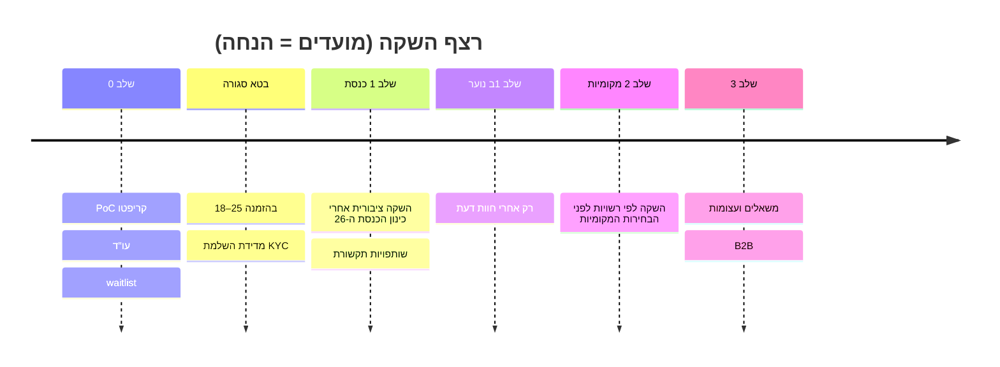

# יציאה לשוק והתאמת מוצר לשוק (GTM & PMF)

[← חזרה לאינדקס](../../README.md)

- **סטטוס:** מוצע (טיוטה v0.1, 2026-10-22). **כל יעד מספרי כאן הוא הנחה** עד שיימדד.
- **יורש מ:** [ציר 09](../axes/09-marketing.md), [ציר 11](../axes/11-youth-growth.md), [mvp-israel](../mvp-israel.md), ADRs [0004](../decisions/0004-election-poll-legal-labelling-blackout-il.md), [0008](../decisions/0008-no-advertising.md), [0010](../decisions/0010-freemium-civic-core-free.md), [0015](../decisions/0015-fast-convenient-app.md).

## 1. פלחי יעד
| פלח | למה | ערך מרכזי | שלב |
|---|---|---|---|
| **18–25 (ליבה)** | צמיחה מהירה, שיתוף ([ציר 11](../axes/11-youth-growth.md)) | "הקול שלי נספר באמת", כרטיסי שיתוף, אפליקציה מהירה | 1 |
| אזרח מעורב 25+ | תוכן ושיח | עמודי ח"כים והצעות חוק, פורומים מכבדים | 1 |
| עיתונאים וחוקרים | אמינות, הפצה | תוצאות מאומתות עם מתודולוגיה פומבית | 1 (חינם), 2–3 (בתשלום) |
| רשויות וארגונים (B2B/B2G) | הכנסה | [שיתוף ציבור](../business/b2b-civic.md) | 2–3 |
| נוער 13–17 | עתיד | רק לפי ADR-0006 **ואחרי עו"ד** | 1ב |

## 2. רצף השקה

- **אין השקה בתקופת בחירות** לכנסת ה-26 ([mvp-israel §2](../mvp-israel.md#2-הקשר-עובדתי-קריטי-בחירות-לכנסת-ה-26)).

## 3. תזמון מול חלון האיסור (§16ה)
- מתום יום שישי שלפני הבחירות ועד סגירת הקלפיות: **הקפאת הצבעה וחשיפת תוצאות סקרי בחירות** (ADR-0004). **אסור לתכנן קמפיין שמבטיח תוצאות בחלון הזה.**
- בתקופת הבחירות: כל תוצאה מסומנת לפי 16ה(ד). שיווק יתמקד בשיח, הסברה ותוכן — לא ב"סקר מנבא".
- **דורש אימות (עו"ד):** האם 16ה חל גם על בחירות מקומיות (L7) – חוסם תכנון שלב 2.
- **הנחה:** קמפיין גיוס מרכזי 3–6 חודשים לפני בחירות, כדי שה-epoch ייבנה לפני החלון.

## 4. מדדי PMF (כל היעדים = הנחה)
| מדד | הגדרה | יעד מוצע (הנחה) |
|---|---|---|
| השלמת KYC | הושלם / התחיל | ≥60% ([ציר 09](../axes/09-marketing.md#הנחות)) |
| D30 retention | פעילים ביום 30 / מאומתים | TBD אחרי בטא |
| הצבעות לשבוע למשתמש פעיל | חציון | TBD |
| Sean Ellis | "מאוכזב מאוד" אם המוצר ייעלם | ≥40% (מקובל בתעשייה – **הנחה**) |
| שיתופים לכל 100 הצבעות | כרטיסי שיתוף | TBD |
| איזון פוליטי | התפלגות הצהרה עצמית (מצרפי, k) לא נוטה למחנה אחד | TBD; **דורש אימות משפטי** לאיסוף |
| אמון | % שמאמינים ש"אף אחד לא יודע מה הצבעתי" | TBD |

**איסור:** אין מדידה פרטנית שמקשרת הצבעה למשתמש לצורך מדדים.

## 5. ניסויים
| # | השערה | ניסוי | הצלחה (הנחה) |
|---|---|---|---|
| X1 | הסבר פרטיות קצר מעלה השלמת KYC | A/B על מסך לפני KYC | +עליה מובהקת |
| X2 | כרטיס שיתוף עם טווחים מניע גיוס | מדידת הפניות | TBD |
| X3 | שאלה יומית מגבירה retention | קבוצת ביקורת | TBD |
| X4 | "בלי פרסומות" כמסר מבדל | בדיקת מסרים | TBD |
| X5 | פרימיום (ADR-0010) | waitlist בתשלום | TBD |

ניסויים רק על חוויה ותוכן, **לעולם לא** על לוגיקת ספירה, ספים או סימון משפטי.

## 6. לולאות משוב
- סקר משתמשים חודשי (מצרפי), ראיונות עומק בבטא, לוח בקשות פומבי, דוח שקיפות רבעוני.
- כל לקח מהותי חוזר לאפיון דרך ADR ([CONTRIBUTING](../../CONTRIBUTING.md)).

## 7. סיכונים
- תיוג פוליטי (לקח Crowdpac – [competitors](../competitors.md)): תמהיל משקיעים ושותפים חוצה מחנות (ADR-0011).
- חיכוך KYC מפיל המרה.
- עונתיות: עניין בבחירות בלבד (לקח Brigade).
